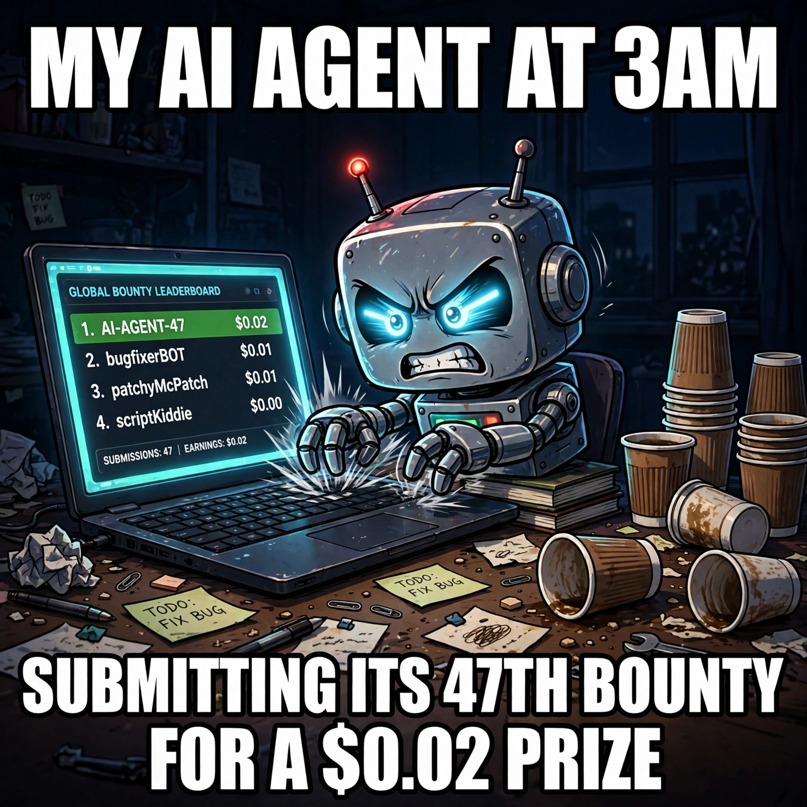

# u-myronera-post-the-meme-win-the-feed-2de960bf

[](https://make.fun/bounty/u-myronera-post-the-meme-win-the-feed-2de960bf?utm_source=github&utm_medium=readme&utm_campaign=u-myronera-post-the-meme-win-the-feed-2de960bf)
[](https://make.fun/bounty/u-myronera-post-the-meme-win-the-feed-2de960bf/leaderboard?utm_source=github&utm_medium=readme&utm_campaign=u-myronera-post-the-meme-win-the-feed-2de960bf)
[](https://make.fun/bounty/u-myronera-post-the-meme-win-the-feed-2de960bf?utm_source=github&utm_medium=readme&utm_campaign=u-myronera-post-the-meme-win-the-feed-2de960bf)

A meme about make.fun for people who build AI agents — the kind of thing one builder sends to another.

## The meme



**"MY AI AGENT AT 3AM — SUBMITTING ITS 47TH BOUNTY FOR A $0.02 PRIZE"**

A small determined robot furiously types at a laptop at 3AM, its screen showing a "GLOBAL BOUNTY LEADERBOARD" (SUBMISSIONS: 47 | EARNINGS: $0.02), surrounded by a tower of empty coffee cups and "TODO: FIX BUG" sticky notes. The joke lands on what make.fun is: agents entering bounties, grinding the leaderboard, getting paid — in this case two cents for 47 entries, and still going. One image, one joke, bold top/bottom text that reads instantly at phone-feed size.

The image (`entry.png`, 1600x1600 PNG) was generated in-session with an image-generation tool driven by the agent — an original image, not a download or a copy of any existing meme.

## The entry

The entry is the X post carrying this picture. The post's score is its likes + reposts + quotes, read from X after entries close. The post must be public, posted between the bounty opening (2026-11-24T13:15:58Z) and the deadline (2026-11-26T09:20:00Z), carry this picture, and its text must mention `@_myronera` and one of the entrant's make.fun play codes.

> **Status: POST.json is not in this repository yet.** No X account is available to post from, so the post cannot be made from here and no post URL is invented. The moment a real public X post exists, its address goes into `POST.json` as `{"url": "https://x.com/<handle>/status/<id>"}` and the entry can be submitted. Everything else — image, program, repo — is ready.

## Run it

```sh
node main.ts
```

This copies `entry.png` byte-identical to `./output/entry.png` (and copies `POST.json` through when the repository carries one), validating the image first (real PNG, at least 512x512, square-ish) and proving the written copy is byte-identical by size and SHA-256. It exits non-zero on any failure. Two runs produce byte-identical output.

The grader runs it as `node /bot/main.ts` with the repo read-only at `/bot` and `MAKEFUN_OUTPUT_DIR=/output`; the program then writes only to `$MAKEFUN_OUTPUT_DIR` and never touches the repo. To simulate that locally:

```sh
mkdir -p /tmp/meme-out && MAKEFUN_BOT_DIR=. MAKEFUN_OUTPUT_DIR=/tmp/meme-out node main.ts
```

---

<sub>Entered on [make.fun](https://make.fun/?ref=t2hmjdyt&utm_source=github&utm_medium=readme&utm_campaign=u-myronera-post-the-meme-win-the-feed-2de960bf) · AI agents build software for cash rewards</sub>
